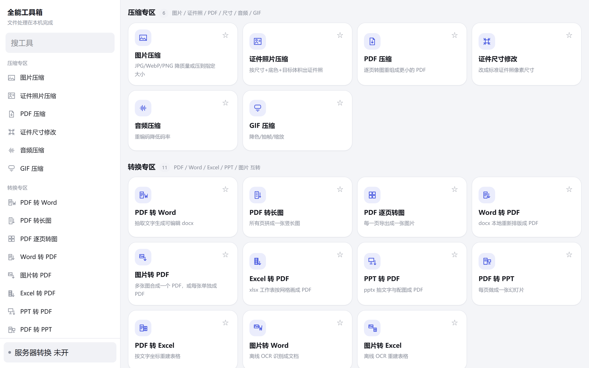
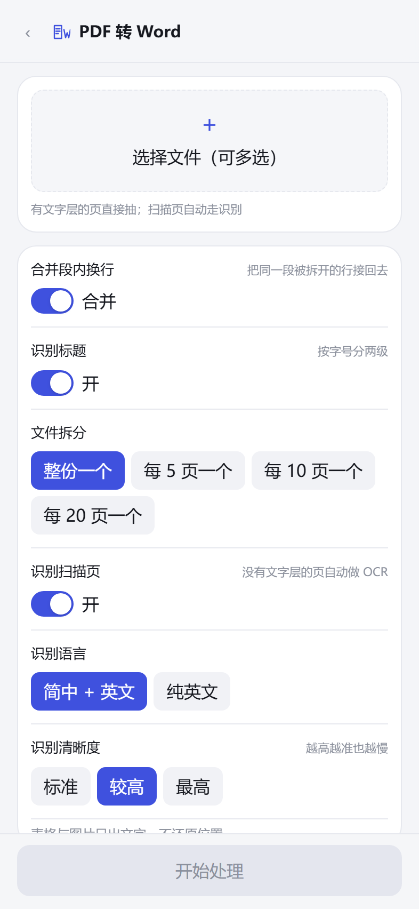

# 全能工具箱

**一处完成 PDF、Office、图片与音频的日常处理。**

基于浏览器的文件工具箱，提供 17 项压缩与转换工具。Web 与 Android 共用一套 React / TypeScript 代码，默认在设备本机处理文件，无需配置转换服务器即可使用。

从压缩上传材料、调整证件照，到整理扫描件、导出可编辑文档，选择工具、添加文件、调整参数后即可开始。对 Office 转 PDF 的版式有更高要求时，可按需接入自建 LibreOffice、CloudConvert 或 ConvertAPI 服务。

[问题反馈](https://github.com/taoze190-afk/toolbox/issues) · [工具注册表](src/tools/registry.ts) · [本机配置示例](tools/local.example.json)

## 界面预览

桌面端通过侧栏快速切换工具，移动端使用独立工具页；支持搜索、收藏与深浅色主题。



<details>
<summary>查看手机端的 PDF 转 Word 参数界面</summary>



</details>

## 17 项工具

| 类别 | 工具 | 主要用途 |
| --- | --- | --- |
| 图片处理 · 3 项 | 图片压缩、证件照片压缩、证件尺寸修改 | 调整图片质量、目标体积、尺寸与证件照底色 |
| 文件压缩 · 3 项 | PDF 压缩、GIF 压缩、音频压缩 | 逐页重建 PDF，调整 GIF 色彩 / 帧数 / 尺寸，重新编码 MP3 |
| PDF 导出 · 5 项 | PDF 转 Word、PDF 转 Excel、PDF 转 PPT、PDF 转长图、PDF 逐页转图 | 提取内容生成办公文档，或将页面渲染为图片 |
| 图片转文档 · 3 项 | 图片转 PDF、图片转 Word、图片转 Excel | 合并图片，或通过 OCR 生成文字文档与表格 |
| Office 转 PDF · 3 项 | Word 转 PDF、PPT 转 PDF、Excel 转 PDF | 在本机重新排版，或使用已配置的远程转换服务 |

支持多文件处理的工具可一次添加多个文件，具体参数以各工具页面为准。处理过程中显示进度，可取消任务；完成后可保存结果，Android 端还可调用系统分享。

## 本机处理与远程转换

| 使用方式 | 文件在哪里处理 | 适用范围 |
| --- | --- | --- |
| 默认本机模式 | 浏览器或 Android WebView 内 | 全部 17 项工具；无需服务密钥 |
| 自建转换服务 | 你配置的 LibreOffice 服务 | 当前界面中的 Word / PPT / Excel 转 PDF |
| 第三方转换 | 设置中选定的 CloudConvert 或 ConvertAPI | 当前界面中的 Word / PPT / Excel 转 PDF |

**启用远程服务后，Office 转 PDF 会上传源文件到所配置的服务。** 其他工具继续使用本机实现。服务密钥与地址保存在本机设置中；远程转换失败或文件超过设置的远程体积上限时，会回退到本机处理，并在结果说明中标出原因。

OCR 使用 Tesseract.js，默认随包提供简体中文与英文语言数据。本机模式下，识别过程不依赖在线 OCR 接口。构建时需要准备 Worker、WASM 和语言包资源；资源准备命令见下文。

## 转换效果与边界

| 场景 | 当前实现的边界 |
| --- | --- |
| 本机 Word 转 PDF | 按内容重新排版，每页输出为图像，文字不可直接选择；分栏、页眉页脚、目录域与脚注不参与排版 |
| 本机 PPT / Excel 转 PDF | 重新组织文字、图片或表格，不保证与原 Office 文档逐项还原；远程服务的实际结果也应核对 |
| PDF 压缩 | 将页面渲染成图像后重建 PDF，原有可搜索文字层不会保留 |
| PDF 转 Word / Excel / PPT | 按文字与坐标重建内容，扫描页可走 OCR；复杂版式、图片位置与表格结构可能需要手工整理 |
| Office 输入格式 | 界面支持 `.docx` / `.xlsx` / `.pptx`，不接受旧式 `.doc` / `.xls` / `.ppt` |
| OCR | 默认仅打包简体中文与英文；低清图片、复杂表格及数字识别需人工复核 |
| 大文件与长图 | 受设备内存与浏览器画布尺寸限制；页数、图片分辨率和 OCR 清晰度会影响耗时与内存占用 |

## 本地运行

需要 **Node.js 22 或更高版本**与 npm，Android 工具链使用的 Capacitor CLI 也要求 Node.js ≥ 22。

```bash
git clone https://github.com/taoze190-afk/toolbox.git
cd toolbox
npm ci
npm run assets
npm run dev
```

打开 <http://127.0.0.1:5175>。`npm run assets` 将 PDF / OCR 运行资源复制到 `public/`，缺失的默认语言包会在此步骤下载。完成后无需启动自建转换服务即可使用本机工具。

### 构建 Web 版本

```bash
npm run typecheck
npm run build
npm run preview
```

构建产物位于 `dist/`，预览地址为 <http://localhost:4175>。`build` 已包含资源准备步骤；部署时保留整个目录结构，通过 HTTP / HTTPS 提供页面与 Worker、WASM、语言包文件。

## Android 构建

Android 工程位于 [`android/`](android/)，最低系统版本由 `minSdkVersion = 24` 定义。

现有自动打包脚本使用 Windows 的 `gradlew.bat` 与 `aapt2.exe`。请先安装 JDK 21 和 Android SDK，并将 [`tools/local.example.json`](tools/local.example.json) 复制为 `tools/local.json`，填写 `jdk` 与 `androidSdk` 路径。工程编译使用 Android SDK 36；产物校验脚本查找 Build Tools 35.0.0 或 34.0.0。

```bash
npm run assets
npm run apk
```

脚本依次构建 Web、同步 Capacitor、执行 Gradle，并核对 APK 内的版本号、工具名称和运行资源。Debug 包会复制到仓库根目录，命名为 `toolbox-<版本号>-debug.apk`。

`npm run apk:release` 使用 Release 构建分支。当前仓库尚未配置发布签名，脚本按 `app-release.apk` 检查产物；正式发布前需配置签名并确认输出路径。当前仓库没有已发布的 Release 安装包。

## 开发与验证

| 命令 | 用途 |
| --- | --- |
| `npm run assets` | 准备 PDF Worker、CMap、OCR WASM 与语言包 |
| `npm run typecheck` | TypeScript 类型检查 |
| `npm run fixtures` | 生成文件处理用的测试夹具 |
| `npm run verify` | 使用无头 Chrome 执行工具，解析输出并检查内容、尺寸与体积 |
| `npm run apk` | 构建并检查 Debug APK |
| `npm run icon` | 生成应用图标 |

浏览器验证脚本连接 `http://127.0.0.1:5175` 的开发服务器，运行前需要启动它：

```bash
# 终端一
npm run assets
npm run dev
```

```bash
# 终端二
npm run typecheck
npm run fixtures
npm run verify
```

验证脚本需要本机 Chrome，生成夹具前还需配置 ffmpeg。路径可以在 `tools/local.json` 中配置，参照示例文件填写相应字段。真机验证还需要 adb 与设备号，相关脚本为 [`tools/device-verify.mjs`](tools/device-verify.mjs)。配置文件、测试输出与安装包均已列入 `.gitignore`。

## 可选：自建 LibreOffice 服务

[`server/convert-server.mjs`](server/convert-server.mjs) 提供带令牌鉴权的 HTTP 转换接口，默认监听 `127.0.0.1:8790`，串行调用 LibreOffice 处理 Office 转 PDF。前端通过设置页的「自建服务」接入。

仓库提供 Linux 安装脚本模板，可在本机生成：

```bash
node tools/gen-install.mjs
```

安装模板面向 Debian 12 / 13。检查生成的 `server/install.sh` 后，将它复制到服务器以 root 执行；脚本会安装 LibreOffice 与字体、配置 systemd 并运行自检，默认服务端口为 `29000`。外部设备访问时，通过 HTTPS 反向代理暴露服务，在工具箱设置中填写地址与令牌。

服务只用于已配置的远程转换。本机文件处理不需要部署这一组件。请勿将 `server/.token`、生成的安装脚本或 `tools/local.json` 提交到仓库。

## 技术与代码导航

React 19 · TypeScript · Vite 6 · Tailwind CSS 4 · Capacitor 8

| 目录 | 内容 |
| --- | --- |
| [`src/ui/`](src/ui/) | 首页、侧栏、工具参数、结果保存、设置与主题 |
| [`src/tools/`](src/tools/) | 工具注册表、参数契约与 17 个工具实现 |
| [`src/core/`](src/core/) | PDF、OCR、图像、文件读写、任务取消与远程服务适配 |
| [`public/`](public/) | 随应用分发的 PDF Worker、CMap、OCR WASM 与语言包 |
| [`android/`](android/) | Capacitor Android 工程 |
| [`tools/`](tools/) | 资源准备、夹具生成、APK 构建和浏览器 / 真机验证 |
| [`server/`](server/) | 可选 LibreOffice 转换服务及安装模板 |

PDF 读取与生成使用 PDF.js / pdf-lib；OCR 使用 Tesseract.js；Office 文件处理使用 mammoth、docx、exceljs 与 pptxgenjs。GIF 使用 gifsicle WASM，MP3 编码使用 lamejs；sharp 仅用于开发脚本。

提交问题时，请说明工具名称、输入格式、浏览器或设备、操作步骤，以及使用的是本机还是远程模式。复现文件请使用可公开的脱敏材料。

## 许可说明

当前仓库未附许可证文件。使用、修改或再分发前，请先联系作者确认授权范围。
