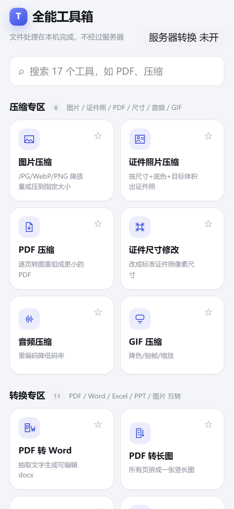
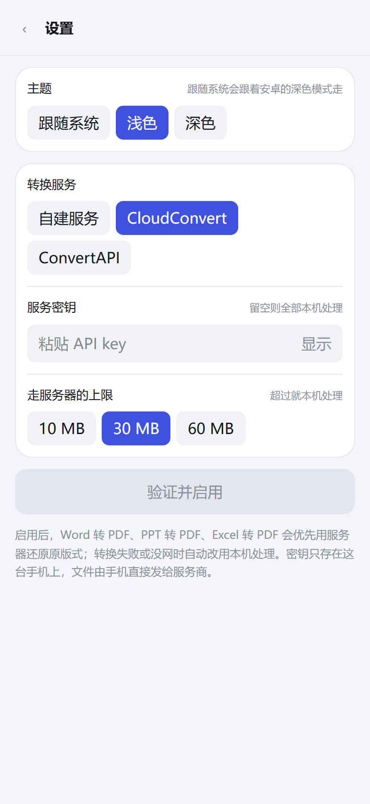
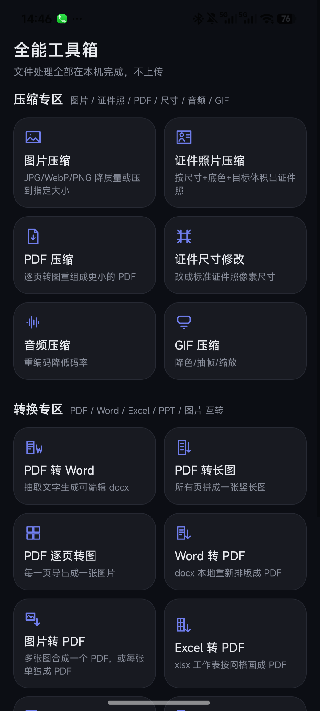

# 全能工具箱

17 个文档和图片工具，都在设备本机跑完，文件不上传。网页版和 Android 版是同一套代码。

## 工具清单

压缩：图片、PDF、GIF、音频，另有证件照片压缩和证件尺寸修改。

转换：PDF 转 Word / Excel / PPT / 长图 / 逐页图，图片转 PDF / Word / Excel，Word / PPT / Excel 转 PDF。

图片转 Word 和图片转 Excel 用 tesseract.js 离线识别，简体中文和英文的语言包打在包里，断网也能用。

## 界面

宽屏左边一条常驻工具栏，窄屏从首页点两下进工具，深浅色跟系统走。







最后一张是真机拍的，前四张是无头 Chrome 渲染。



## 用什么做的

React 19、TypeScript、Vite 6、Tailwind CSS 4，Android 壳是 Capacitor 8。

读 PDF 用 pdfjs-dist，写 PDF 用 pdf-lib。图片走浏览器 canvas，GIF 交给 gifsicle-wasm-browser，MP3 用 @breezystack/lamejs 编码，Office 文件读写分别是 mammoth、docx、exceljs、pptxgenjs。sharp 只在 tools/ 里生成和解析夹具，运行时用不着它。

Word、PPT、Excel 转 PDF 是在本机重新排版的，版式接近但不是一比一。要一比一，就在设置页接一个自建 LibreOffice 服务，或者填 CloudConvert / ConvertAPI 的密钥。

## 限制

- Word 转 PDF 出来每页是一整幅图，字选不中。分栏、页眉页脚、目录域、脚注不参与排版。
- PDF 压缩同样是整页转图，原本有文字层的文件压完文字就选不中了，工具会提示这一句。
- PDF 转 Word / Excel / PPT 只重建文字和表格，版式和图片位置不保留。
- 只吃 .docx / .xlsx / .pptx，更老的 .doc / .xls / .ppt 不认。
- 中文 OCR 认得不算准，语言包也只带了简体中文和英文。

## 跑起来

要 Node 22 或更高。

```bash
npm install
npm run dev        # http://127.0.0.1:5175
```

## 打 Android 包

JDK 21 和 Android SDK 的路径写在 tools/local.json 里（见最后一节）。

```bash
npm run apk            # debug
npm run apk:release    # release
```

脚本依次跑 vite build、cap sync android、gradlew assemble，把包拷到仓库根目录，再用 aapt2 解开核对包名、版本号、17 个工具名和随包资源齐不齐。

## 验证

```bash
npm run typecheck
npm run fixtures       # 往 fixtures/ 生成夹具
npm run verify         # 37 条用例
```

verify 会起一个预览服务，用无头 Chrome 真跑每个工具，把产物拉回 Node 侧解析：页数、尺寸、体积、识别出来的文字，逐项对上才算过。构建日志写着 BUILD SUCCESSFUL 不算。

真机跑同一批用例：`node tools/build-apk.mjs --test` 打出带测试钩子的包，装上后跑 `node tools/device-verify.mjs`。

## 自建转换服务

`server/convert-server.mjs` 是 LibreOffice 的一层 HTTP 包装，只监听 127.0.0.1，带令牌鉴权，一次只处理一个任务。

```bash
node tools/gen-install.mjs     # 生成 server/install.sh
```

把 server/install.sh 拷到服务器上 `bash install.sh`，它装 LibreOffice 和中文字体、建 systemd 服务并限死内存、跑一轮自检，最后打印要填进 App 的地址和令牌。对外访问建议用 1panel 建反向代理套上 HTTPS，只映射一个高位端口。

`server/.token` 是本机令牌，`.gitignore` 已经排除，别提交。

## 目录

```
src/                        43 个文件，约 6.9k 行
  App.tsx  main.tsx         外壳与入口
  index.css                 Tailwind 入口和设计变量
  core/                     引擎层，12 个文件
    pdf.ts                  读页、取文字块与坐标、按 dpi 渲染成图
    scan.ts                 没有文字层的页渲染后识别，坐标反算回 pt
    ocr.ts                  调 tesseract，放大、擦格线
    images.ts               canvas 解码编码，二分压到指定体积
    remote.ts               三个服务商的上传，失败逐文件回落本机
    io.ts                   文件读写与保存，Android 走 Capacitor Filesystem
    jobs.ts                 进度、取消、让出主线程
    settings.ts theme.ts presets.ts format.ts assets.ts
  tools/
    registry.ts types.ts    注册表与参数面板的契约
    defs/                   17 个工具，一个文件一个：面板加 run
  ui/                       首页、侧栏、ToolView、设置、图标、hash 路由

public/                     随包二进制：pdfjs 的 worker 和 168 个 cmaps、
                            tesseract 的 wasm、两个语言包
tools/                      23 个脚本：构建 APK、生成夹具、无头与真机验证、
                            生成安装脚本
server/                     convert-server.mjs 服务本体、install.tpl.sh 安装
                            脚本模板、fake-soffice.mjs 本机测试替身
android/                    Capacitor 生成的安卓工程，只提交源码和图片资源
docs/screens/               README 用的截图
```

## 本机配置

tools/ 下的脚本要用到本机的 adb、JDK、Android SDK、ffmpeg、Chrome 路径和你的设备号。这些值不进仓库：把 tools/local.example.json 复制成 tools/local.json，改成自己的。缺哪一项，脚本会直接报出来。

## 安装

Releases 里有 debug 签名的 APK，装上就能用，文件不出设备。

## 许可

没附许可证文件，版权归作者所有。要用的先来问。
